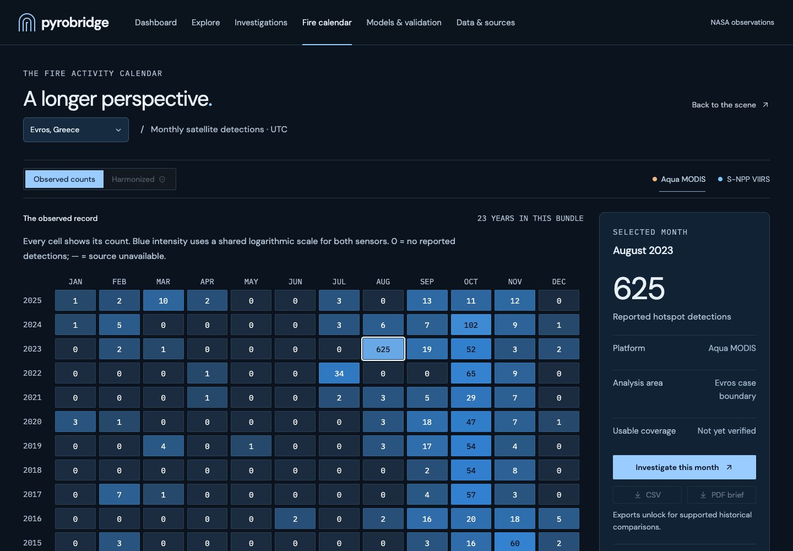

# Mission dashboard redesign

The current release loses geographic context at close zoom, swaps renderers during navigation, changes the page layout during selection, and hides the project's scientific purpose. The new design must explain why MODIS and VIIRS need harmonization while preserving the evidence needed to investigate it.

## Acceptance criteria

- A dashboard communicates the sensor difference, overlap-based modeling, held-out evaluation, and intended historical calendar within a recorded clip of at most 30 seconds.
- Dashboard, exploration, calendar, models, and sources have visible navigation. Existing investigation and scientific functionality remains accessible.
- Earth → region → area → observation uses one persistent geographic view. Camera motion, controls, breadcrumbs, and information panels retain their spatial relationship. Backtracking and interruptions work.
- Global hover includes count, geography, acquisition dates, and an additional useful statistic. Close zoom retains imagery, location context, scale, pan, zoom, and readable observation details.
- Satellite detections use restrained scientific marks. Sensor counts, confidence, footprint, time, source, and model evidence retain their actual meanings.
- The dashboard compares actual MODIS and VIIRS observations and exposes the current fitted models and held-out errors. Experimental scope and incomplete monthly validation are explicit.
- Desktop and phone layouts, keyboard controls, reduced motion, and the deepest supported zoom are inspected in Chrome DevTools. Both local and private Tailscale previews work.
- After implementation, commit and tag a savepoint, record and inspect a ≤30-second clip, and evaluate a 5–6 minute presentation against NASA judging guidance and comparable prior projects. Record weaknesses, iterate where progress is possible, and leave a PR open for review.

## Design decisions to test

Use a persistent MapLibre globe that transitions into the local map, with NASA imagery and real observation layers. Keep a stable navigation frame and four geographic levels. The dashboard's four scientific chapters use the same scene and real case data. Reserve a fixed information area so interaction changes its contents without moving the map or scrolling the user away from the selected location.

The current benchmark has 48 eligible cell-passes in two Greek regions. A winner-quality scientific claim needs stronger monthly validation than this sample provides. The dashboard must make the measured experiment understandable without presenting unsupported historical estimates.

## Review log

### Review 1 — persistent map and restored scientific navigation

Implemented a single MapLibre globe/map, stable four-depth navigation, richer hover, country locator, 7,342 Natural Earth place labels, reprojected dated NASA scenes, and an interactive four-chapter scientific introduction. Calendar preview cells now open their exact month. Six navigation destinations remain visible, including all three historical investigations. Removed the retired globe/map renderers and emoji-like fire symbols.

Verified in Chrome DevTools at 1440×960: the same canvas survives region → area → observation → area → region → Earth; its rectangle stays 1070×788 at (370,82), without page scrolling. Current breadcrumb is a no-op. Inspected the original reading at 42.362° N, 21.715° E (97.8 MW, NOAA-20, 13 Nov 2026 12:14 UTC), with a Serbia locator. Hover displays count, highest FRP, date range and daytime count. Keyboard Tab/Enter selects a region and arrow keys operate the map. June 2022 in the preview opens June 2022 in Evros's full calendar. All scientific destinations load without browser errors. Reduced-motion navigation is immediate. Phone inspection at 390×844 found chart controls overlapping the evidence panel; layering was corrected. Production and Tailscale HTTP checks return 200.

Validation: 12 pipeline tests and 8 frontend tests pass; TypeScript and production build pass. Core offline cache is 29.7 MB. The existing build-size warning now includes the MapLibre renderer. Global deep imagery is a context basemap, not reconstructed fine-resolution data.

Pending this checkpoint's recording and critique: judge whether the four chapters explain the concept within 30 seconds, inspect the animation itself, verify final phone and offline flows, and identify the next meaningful iteration.

### Recording review and second iteration

Tagged `savepoint/mission-dashboard-review-1` at `612c28a` before review. Recorded the actual app, measured the first clip at **24.38 seconds**, and inspected a contact sheet and flight frames. The persistent camera and stable layout are a substantial improvement over swapping a globe for a separate map. The concept is present, but the benchmark bars alone leave the actual prediction process too abstract; long introductory prose also competes with the imagery.

The second iteration shortens the explanation and adds a held-out experiment viewer to Models & validation. It publishes the existing regional/time prediction artifact directly from training, allows all four fitted/control approaches and either withheld region, preserves all 48 rows including 42 zero targets, and exposes each prediction/target/error. The chart uses a shared scale across models. The regional MAE and nonzero-target MAE make the effect of zero-heavy sampling visible. Two artifact-consistency tests reproduce every regional score and check that the public download matches the original saved predictions. This is an inspection tool for measured experiments, not an invented demonstration dataset.

Also removed duplicate initial observation-source processing, added a loading indicator, and corrected world framing after viewport resizing. The second live recording is **25.77 seconds** (25.8 seconds after H.264 conversion) and uses ordinary buttons: Earth → Evros MODIS → VIIRS → mean holdout errors → withheld Evros → calendar preview → August 2023 in the full calendar. Inspected chapter frames and the final calendar frame. The H.264 deliverable is `artifacts/mission-review/pyrobridge-demo.mp4`; the original recordings remain local. Review images are in `docs/review/`.

Final verification: 12 pipeline tests and 10 frontend tests pass; production build passes. Tailscale was inspected in a fresh browser context at 390×844. The evidence card no longer overlaps map controls, the experiment viewer scrolls within its chart, and there is no horizontal page overflow. With Chrome DevTools set to Offline, a normal reload retained the featured imagery, sensor counts, evidence and experiment rows. This is browser emulation, not a physical-phone airplane-mode test. Core cache: **29.8 MB / 411 files**. No browser errors in the final online phone and desktop sessions.

### Five-to-six-minute presentation review

A rehearsable 5:30 sequence:

| Time | Interaction and point to establish |
| --- | --- |
| 0:00–0:30 | Dashboard: better sensors can create an apparent change in activity. |
| 0:30–1:20 | Evros: toggle 162 daytime MODIS and 929 VIIRS detections; explain separate sampling and why their ratio is not a calibration. |
| 1:20–2:00 | Explore region → area → observation; inspect UTC time, footprint, FRP and source. Explain that pixels are not incident perimeters. |
| 2:00–3:30 | Models: choose each withheld region, compare seasonal scaling with LightGBM, inspect a large error and a zero target. Show the complete prediction download and coverage audit. |
| 3:30–4:30 | Calendar: choose an actual historical month, investigate its original records, and show the disabled harmonized mode with its reason. |
| 4:30–5:30 | Sources and next milestone: explain reproducibility, common observation opportunity, geographic/time holdouts, and the evidence still needed for historical transfer. |

I would not award this first place on the current scientific evidence. The presentation is coherent and the reproducible, inspectable experiment is a credible differentiator. The central released output is still an observed calendar; a validated harmonized monthly record remains absent. More animation cannot close that gap.

For comparison, NASA describes 2024 Local Impact winner Team I.O./G.R.O.W. as making complex environmental GIS accessible. Its public repository documents satellite maps, historical context and a voice interface. Merely adding another globe would be weak differentiation; PyroBridge's inspectable cross-sensor calibration is the stronger contribution. [NASA 2024 winners](https://www.nasa.gov/learning-resources/stem-engagement-at-nasa/nasa-international-space-apps-challenge-announces-2024-global-winners/) · [G.R.O.W. repository](https://github.com/Florianopolis-NASA-Space-Apps/wildfires_chat_dashboard)

NASA's 2025 summary describes SkySense as supporting weather decisions, and SpaceGenes+ as an accessible research dashboard. My inference is that a clear user decision and visible analytical depth matter more than visual novelty alone; these summaries do not prove how complete or validated those applications were at judging time. [NASA 2025 winners](https://www.nasa.gov/learning-resources/stem-engagement-at-nasa/nasa-announces-2025-international-space-apps-challenge-global-winners/)

Using the **2025** published rubric as a historical reference, impact, creativity, validity, relevance and presentation all matter. The redesign improves presentation and usability; the scientific release gap primarily limits validity and challenge completion. This is a qualitative self-review, not an official score or a prediction of placement. [Published judging guidance](https://spaceapps-v2-staging.s3.amazonaws.com/media/documents/Final_Space_Apps_2025_Judging_Guidelines_for_web.pdf)

### Remaining evidence and decisions

- Historical harmonization needs a larger, geographically varied sample, a locked evaluation set and complete monthly observing-effort records. The current selected passes cannot answer that question, regardless of additional UI refinement. Dataset expansion and validation criteria are the next scientific workstream, not a cosmetic iteration.
- Test the revised hierarchy and motion with an actual fire manager and on the team's physical phones. Browser emulation cannot establish comprehension, operational usefulness or real-device smoothness. Record whether an unfamiliar person explains the sensor-change problem correctly after the short clip.
- Global deep background imagery remains coarse context; country locators, place labels and coordinates prevent loss of orientation. Higher-resolution global imagery would need a deliberate source/size/licensing choice. The three dated cases have local, georeferenced NASA scenes.
- The current visual review has reached a useful checkpoint. More solitary style iteration would provide weaker evidence than the above user and scientific tests. The PR stays open; no deployment or merge is part of this handoff.

## Sensor context and readability review — 15 November 2026

The country locator now follows the camera at zoom 4.5 and above. It appears without a selected pixel in Explore and in all three dashboard sensor comparisons. Its white viewport outline updates during zoom and pan. The same locator is available in the historical split comparison. The selected pixel keeps its sensor color with a white ring. MODIS is amber, VIIRS is blue, and only mixed-sensor groups are gray. Country outlines combine Natural Earth map units such as Belgium's constituent regions; distant overseas territories keep their local context. Source geometry and all observation assignments were verified unchanged.

The dashboard comparison now offers Evros (162 MODIS / 929 VIIRS daytime detections), Evia (54 / 153), and Gran Chaco (155 / 562). Each count was reconciled with the original dated scene rows and the case boundary. Separate overpasses remain explicit. Gran Chaco does not supply eligible five-minute calibration pairs; entering the model experiment moves to the supported Greek sample.

The model experiment compares the unchanged MODIS rate evaluated at common usable area, a selected model's held-out estimate, and the actual VIIRS target. Both regions, three fitted approaches, and every eligible cell-pass are selectable, including zero targets. Errors can improve or worsen. For example, the Evros 104-pixel target has a 44.8-pixel unchanged-rate control and a 119.1-pixel LightGBM estimate. On the Evia 80-pixel target, LightGBM estimates 4.3 and performs worse than the 21.9 control. These are existing regional-holdout predictions, not new fits or a monthly historical release.

All active pages share the blue interface theme. Body copy in the scientific workspace is 16 px, supporting text is generally 14–15 px, and calendar counts remain visible at 14 px. Calendar cells distinguish zero from unavailable sources and select black or white text from the actual fill luminance. All six case/sensor combinations were measured in Chrome: minimum count contrast ranged from 4.58:1 to 8.37:1. At 390 px width, only the calendar grid scrolls horizontally; the document remains 390 px wide. Larger historical comparison controls were repositioned to avoid overlapping the locator, captions, or source credits.

Verification used the official Chrome DevTools MCP server through a local stdio client, with desktop (1440 × 1000) and touch-phone (390 × 844) emulation. Browser checks covered sensor toggles without camera movement, all three landscapes, locator visibility without selection, MODIS and VIIRS selected-marker colors, live viewport changes on zoom and keyboard pan, hiding the locator at globe scale, historical split comparison, model changes and zero-target examples, calendar keyboard selection, and all page layouts. Normal-motion and reduced-motion sessions were inspected. The production preview reported no browser console errors. This does not substitute for a physical-phone usability session.

The 17 frontend tests, 12 pipeline tests, TypeScript, geography/source consistency check, and production build pass. Both localhost and the existing private Tailscale preview were verified against the production HTML and assets. The offline core remains 30.7 MB. No preview configuration or Earthdata credentials changed.

